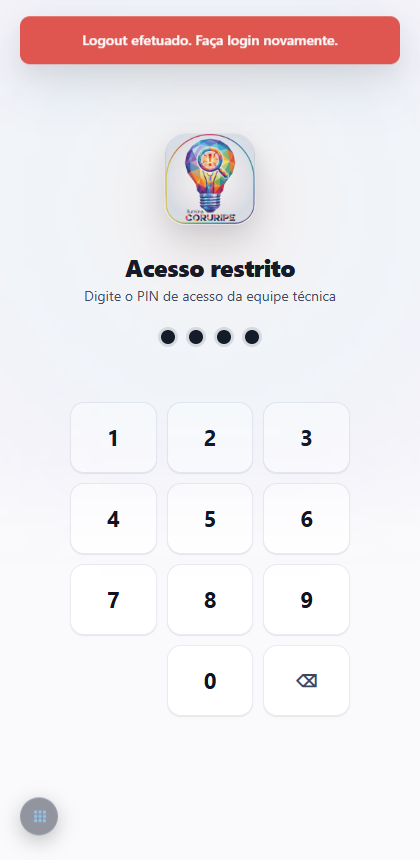
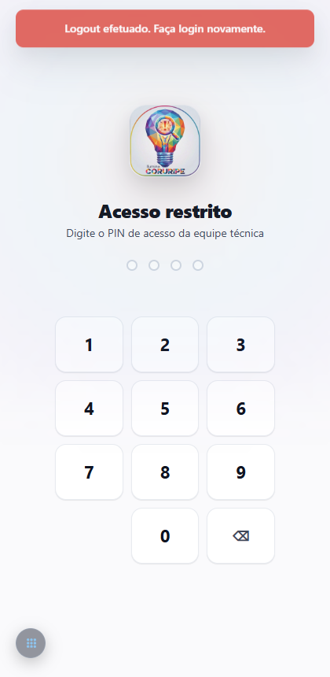

# Relatório de Testes — Logout do técnico limpa o PIN (PR #14)

- **Responsável pelos testes:** Davi Santiago de Jesus
- **Data:** 26/11/2026
- **Funcionalidade:** login por PIN do painel do técnico (UC04)
- **Correção testada:** PR #14 `fix/limpar-pin-logout`, de Natalia, versão `d812ce0`
- **Base de comparação:** `main` em `1e0f7b1` (merge do PR #13)

## O defeito

Depois do logout, o painel voltava para a tela do PIN com os **4 pontos preenchidos**. O PIN digitado antes (`pinBuffer`) não era apagado. Como a função `pinKey` ignora qualquer tecla quando o PIN já tem 4 dígitos, **o teclado ficava travado**. Para entrar de novo, o técnico precisava apertar ⌫ quatro vezes ou recarregar a página.

| | |
|---|---|
| **Defeito (no código)** | `logoutTecnico()` limpava a sessão, mas não zerava `pinBuffer` nem atualizava os pontos |
| **Falha (o que o técnico vê)** | Depois do logout, os pontos aparecem preenchidos e o teclado não responde |
| **Severidade** | Média: o técnico não perde dados, mas não consegue entrar de novo sem recarregar a página |

## A correção (PR #14)

1. `logoutTecnico()` passa a zerar `pinBuffer` e a chamar `updateDots()` (`public/tecnico/index.html`).
2. O botão "Sair" foi para a direita do cabeçalho, embaixo da etiqueta "Técnico".
3. O aviso de PIN errado limpa os pontos em 550 ms em vez de 900 ms.
4. O novo teste CT-29 fica em `server/tests/logout-tecnico.test.js`, e `teste-pin/README.md` ganhou a linha do CT-29.

### Histórico da revisão

| Rodada | Versão | Resultado |
|---|---|---|
| 1ª | `f21f7fc` | **Mudanças solicitadas.** O CT-29 ficava em `suite-cts.test.js` e usava funções do navegador (`updateDots`, `document`) que não existem no Node: `ReferenceError` e check "Testes" vermelho. O `teste-pin/README.md` tinha sido corrompido (de 5 KB para 1,5 MB). |
| 2ª | `d812ce0` | **Aprovado nos testes deste relatório.** O CT-29 foi reescrito com dublês, o README foi restaurado e a mudança de cache que não tinha relação com a correção foi desfeita. |

## Como os testes foram feitos

Os testes rodaram numa **cópia isolada da `main` com o merge do PR aplicado**, sem alterar a `main`. Cada teste também rodou na `main` pura, para comparar antes e depois.

- **Unidade (caixa-branca):** o CT-29 roda as funções **reais** `updateDots` e `logoutTecnico`, recortadas do HTML pelo apoio `extrair-funcao.js` dos testes offline. A tela é trocada por dublês: um *fake* do `document` e *spies* de `showScreen`, `limparSessao` e `showToast`.
- **Regressão:** a suíte completa (`npm test`) rodou com a mesma sequência do GitHub Actions, contra um MySQL 8.0 descartável.
- **Sistema (caixa-preta):** o Chrome sem janela, controlado pelo Playwright, usa só a tela: clica no teclado, entra com o PIN 0123 na **API Node real** com MySQL, clica em "Sair" e tenta entrar de novo.
- **Integridade dos arquivos:** o check "Verificar arquivos" (PR #15) confere se algum `.md`/`.txt` do PR está corrompido ou inchado.

**Ambiente:** Windows 10, Node.js 24.16.0, MySQL 8.0.46 (Docker), Google Chrome 158 com `playwright-core` 1.65.1.

## Casos de teste e resultados

| Caso | Técnica | Nível | O que verifica | Esperado | `main` (antes) | `main` + PR (depois) |
|---|---|---|---|---|---|---|
| CT-29 | Caixa-branca, dublês | Unidade | Logout zera `pinBuffer`, apaga os pontos, limpa a sessão e volta para a tela do PIN | Passa | ❌ Falha ("pinBuffer deve ficar vazio após o logout") | ✅ Passa |
| L-01 | Caixa-preta | Sistema | Botão "Sair" escondido na tela do PIN | Escondido | ✅ | ✅ |
| L-02 | Caixa-preta | Sistema | Login com PIN 0123 abre o painel | Abre | ✅ | ✅ |
| L-03 | Caixa-preta | Sistema | Botão "Sair" visível no painel | Visível | ✅ | ✅ |
| L-04 | Caixa-preta | Sistema | Logout volta para a tela do PIN | Volta | ✅ | ✅ |
| L-05 | Caixa-preta | Sistema | Pontos do PIN depois do logout | 0 preenchidos | ❌ 4 preenchidos | ✅ 0 |
| L-06 | Caixa-preta | Sistema | Sessão apagada do aparelho (`localStorage`) | Apagada | ✅ | ✅ |
| L-07 | Caixa-preta, transição de estado | Sistema | Teclado aceita dígito depois do logout | 1 ponto | ❌ Travado (4) | ✅ 1 |
| L-08 | Caixa-preta, transição de estado | Sistema | Novo login sem recarregar a página | Entra | ❌ Não entra | ✅ Entra |
| L-09 | Informativo | Sistema | Tempo para limpar os pontos depois de PIN errado | ~550 ms | ~917 ms | ✅ ~566 ms |
| L-10 | Caixa-preta | Sistema | Erros de JavaScript na página | 0 | ✅ 0 | ✅ 0 |
| V-01 | Inspeção automatizada | Repositório | `.md`/`.txt` do PR sem corrupção | OK | — | ✅ `teste-pin/README.md` 5,3 KB → 5,4 KB |

### Regressão (suíte completa, mesma sequência do CI)

| | `main` (antes) | `main` + PR (depois) |
|---|---|---|
| Testes | 310 | 311 (+CT-29) |
| Aprovados | 300 | **301** |
| Falhas | 0 | **0** |
| Pendentes (`todo`) | 10 | 10 |

Os 10 pendentes são os mesmos nos dois lados e não têm relação com o PR. Eles marcam defeitos já conhecidos: DEF-01, DEF-03, DEF-04, DEF-11 e DEF-12 dos [testes offline](<../Testes offline/README.md>), e o DEF-13 do teste de integração INT-13.

No GitHub, o PR #14 na versão `d812ce0` tem o check **testes** verde e o deploy de prévia da Vercel concluído.

### Capturas de tela

| | Antes | Depois |
|---|---|---|
| Cabeçalho do painel |  |  |
| Tela do PIN logo após o logout |  |  |

## Conclusão

A correção resolve o defeito: depois do logout, os pontos ficam vazios e o técnico consegue entrar de novo sem recarregar a página. O CT-29 detecta o defeito, porque falha no código antigo e passa no novo, e a suíte completa não teve nenhuma regressão.

## Limites

- O teste no navegador usou o Chrome em tamanho de celular (420 × 860). Não foi testado em aparelho físico nem em outros navegadores.
- O L-09 mede o tempo aproximado e serve só para registro, não como critério de aprovação.
- O MySQL usado foi descartável e criado pelo `setup-auth-mysql.js`, com o técnico de teste (PIN 0123), não o banco da equipe.

## Como repetir

Testes automáticos (na raiz do projeto):

```bash
npm install --prefix server
node --test server/tests/logout-tecnico.test.js   # só o CT-29
npm test                                         # suíte completa (precisa do MySQL, ver .env.example)
node scripts/ci/verificar-arquivos-pr.mjs origin/main HEAD   # V-01, depois do merge do PR #15
```

Teste no navegador (precisa da API Node no ar em `http://localhost:3001` e do Google Chrome):

```bash
npm install --no-save playwright-core
ILUMINA_API_URL=http://localhost:3001 npm run build
npm run start:server          # em outro terminal
node "docs/Relatório de Testes/Logout do técnico/scripts/logout.navegador.mjs" public depois ./saida
```

## Evidências

| Arquivo | Conteúdo |
|---|---|
| [01-verificar-arquivos.txt](evidencias/01-verificar-arquivos.txt) | V-01: check de integridade dos arquivos do PR |
| [02-ct29-codigo-antigo.txt](evidencias/02-ct29-codigo-antigo.txt) | CT-29 rodando contra a `main` (falha esperada) |
| [03-ct29-codigo-do-pr.txt](evidencias/03-ct29-codigo-do-pr.txt) | CT-29 rodando com o PR (passa) |
| [04-suite-main.txt](evidencias/04-suite-main.txt) | Suíte completa na `main` |
| [05-suite-main-com-pr.txt](evidencias/05-suite-main-com-pr.txt) | Suíte completa na `main` + PR |
| [06-navegador-antes.json](evidencias/06-navegador-antes.json) | L-01 a L-10 na `main` |
| [07-navegador-depois.json](evidencias/07-navegador-depois.json) | L-01 a L-10 na `main` + PR |
| `08` a `11` (`.png`) | Capturas de tela do cabeçalho e da tela do PIN |
| [scripts/logout.navegador.mjs](scripts/logout.navegador.mjs) | Script do teste no navegador |
