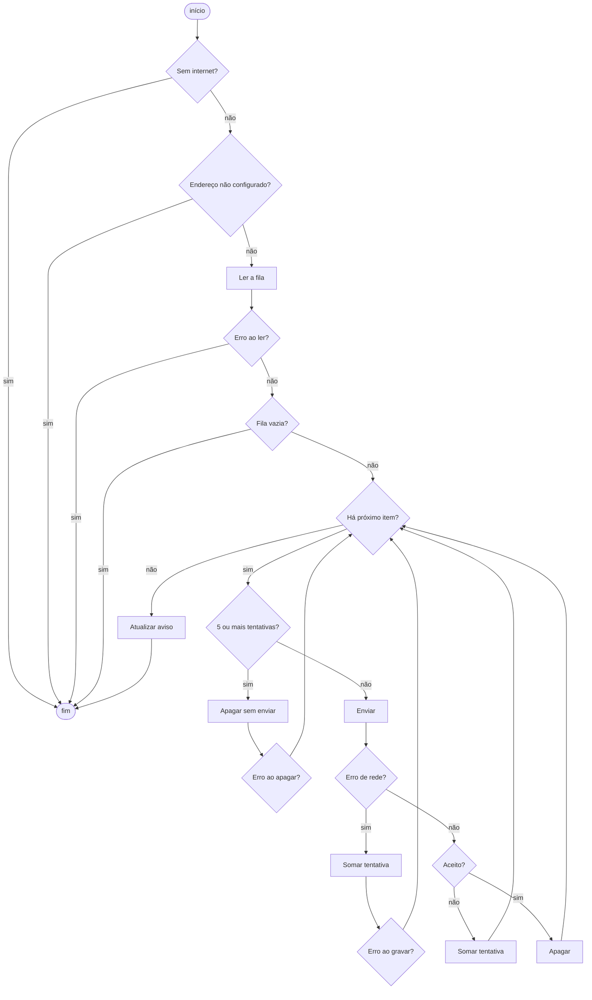
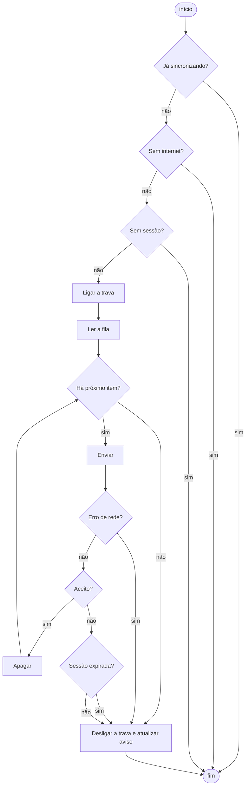

# Caixa-branca — Funcionalidades offline com o servidor Google Apps Script

- **Aluno:** Davi Santiago de Jesus
- **Data:** 12/11/2026
- **Nível de teste:** unidade (funções das telas) e integração (telas ↔ dublê do script)
- **Cenário:** o projeto continua usando o Google Apps Script como servidor
- **Evidência:** [caixa-branca.json](evidencias/caixa-branca.json) (testes, cobertura, complexidade e mutação) · [saída da execução](evidencias/caixa-branca-saida.txt) · [1ª rodada de mutação](evidencias/caixa-branca-mutacao-rodada1.json)

## O que foi testado

No cenário Apps Script, a lógica offline fica toda no aparelho. O servidor é um script no editor do Google, fora do repositório, então **não há código de servidor para testar por dentro**. A caixa-branca cobre as 10 funções das telas que guardam, enviam e sincronizam:

| Função | Onde está | V(G) | O que faz |
|---|---|---|---|
| `flushQueue` (cidadão) | `public/index.html:1271` | **11** | Envia os reportes guardados no aparelho |
| `submitReport` (cidadão) | `public/index.html:1502` | 7 | Decide entre enviar agora ou guardar na fila |
| `updatePendingBanner` (cidadão) | `public/index.html:1259` | 7 | Mostra o aviso de reportes pendentes |
| `postReport` (cidadão) | `public/index.html:1481` | 2 | Faz a requisição, com limite de 60 s |
| `buildPayload` (cidadão) | `public/index.html:1466` | 1 | Monta a mensagem do reporte |
| `generateProtocol` (cidadão) | `public/index.html:1460` | 1 | Gera o protocolo IC-AAMMDD-XXXXX |
| `flushQueue` (técnico) | `public/tecnico/index.html:1868` | 8 | Envia os fechamentos guardados no aparelho |
| `renderPendingBanner` (técnico) | `public/tecnico/index.html:1852` | 5 | Mostra o aviso de fechamentos pendentes |
| `queueCount` (técnico) | `public/tecnico/index.html:1717` | 2 | Conta a fila (limite de 10 fechamentos) |
| `apiFetchTO` (técnico) | `public/tecnico/index.html:1651` | 1 | Faz a requisição com limite de tempo |

V(G) é a complexidade ciclomática, calculada como **decisões + 1**: conta os `if`, os laços, os `catch` e o `?:`. O valor que conta `&&` e `||` também está no JSON.

**O `flushQueue` do cidadão tem 11 caminhos e passa do limite do RNF05** ("cada função com no máximo 10 caminhos diferentes de execução").

## Como os testes funcionam

As funções estão escritas dentro dos HTML, não em módulos. Para testar **o código que roda de verdade sem alterar nenhum arquivo**, o [apoio de extração](../../../../server/tests/testes-offline/apoio/extrair-funcao.js) faz duas coisas:

1. recorta a função do HTML pelo nome;
2. roda o recorte num ambiente isolado (`node:vm`).

O navegador é trocado por dublês ([dubles-cliente.js](../../../../server/tests/testes-offline/apoio/dubles-cliente.js)), com os tipos vistos em aula:

| Dublê | Tipo | Uso |
|---|---|---|
| Banco do aparelho em memória (`Map`) | **Fake** | Implementação simples da fila; devolve cópias, como o IndexedDB |
| Rede que devolve resposta pronta | **Stub** | Respostas no formato do Apps Script: `{ ok }`, `{ success, error }` |
| Objeto `registro` | **Spy** | Anota envios, exclusões, tentativas e avisos |
| `apiFetchTO` que confere o tempo-limite de 40 s | **Mock** | Falha se a fila não usar 40 s por envio |
| Console vazio | **Dummy** | Só para a função ter onde escrever |
| Dublê do Apps Script (servidor de teste) | **Dublê de serviço** | Integração: a função real faz a requisição HTTP real |

Os casos de caminho são escritos uma vez em [casos-cliente.js](../../../../server/tests/testes-offline/apoio/casos-cliente.js) e parametrizados pelo **contrato** de cada servidor (formato das respostas, das recusas e do envio). Assim os cenários Apps Script e API Node cobrem os mesmos caminhos, cada um com os dados do seu servidor.

Cada teste segue o padrão **Preparação → Ação → Verificação (AAA)** e as regras FIRST:

- rápido: a suíte leva cerca de 2 s;
- independente: cada teste monta os próprios dublês;
- repetível: a data e o sorteio do protocolo são fixos (`Date` e `Math.random` controlados);
- autoverificável: o resultado sai das asserções, sem precisar ler o console.

**Testes que confirmam defeitos.** Cinco testes exigem o comportamento correto e falham hoje. Eles estão marcados como `todo`: aparecem com ⚠ e não quebram o `npm test`. É o "ver o teste falhar" do TDD: quando o defeito for corrigido, o teste passa sozinho.

## Grafos de fluxo e caminhos básicos

### `flushQueue` do cidadão — V(G) = 11



| Caminho | Decisão | Teste |
|---|---|---|
| 1 | Sem internet | CBA-01 |
| 2 | Endereço não configurado | CBA-02 |
| 3 | Erro ao ler o banco | CBA-03 |
| 4 | Fila vazia | CBA-04 |
| 5 | Envio aceito | CBA-05 |
| 6 | Recusa (com motivo e resposta vazia) | CBA-06, CBA-07 |
| 7 | Erro de rede (com e sem mensagem) | CBA-08, CBA-09 |
| 8 | 5 tentativas: descarte (valor limite 4/5) | CBA-10 |
| 9 | Erro ao apagar o item descartado | CBA-11 |
| 10 | Erro ao gravar a tentativa | CBA-12 |
| 11 | Laço com 2 itens, o 1º falhando | CBA-13 |

### `flushQueue` do técnico — V(G) = 8



| Caminho | Decisão | Teste |
|---|---|---|
| 1 | Já sincronizando (trava) | CBA-39 |
| 2 | Sem internet | CBA-33 |
| 3 | Sem sessão | CBA-34 |
| 4 | Fila vazia | CBA-35 |
| 5 | Todos aceitos | CBA-36 |
| 6 | Sessão expirada | CBA-37 |
| 7 | Outro erro do servidor | CBA-41 (confirma DEF-07) |
| 8 | Erro de rede | CBA-38 |
| extra | Exceção ao ler a fila (vai direto ao `finally`) | CBA-40 |

As setas "sessão expirada: sim" e "não" levam ao mesmo lugar. **Qualquer recusa trava a fila inteira** (DEF-07), e a sessão expirada não tem tratamento próprio (DEF-09). O teste de mutação confirmou isso (ver abaixo).

## Resultado

**51 testes: 46 aprovados e 5 que confirmam defeitos**, sem nenhuma falha inesperada.

### Cobertura

Medida pelo próprio motor do JavaScript (V8). O relatório do `node --test` não enxerga código executado dentro do `node:vm`, então o [executor](../../../../server/tests/testes-offline/apoio/executar-caixa-branca.mjs) lê a cobertura bruta do V8 e a recorta função por função. "Ramos" são os blocos que o V8 separa: o lado verdadeiro e o falso de cada `if`, cada `catch` e o trecho depois de um `return` antecipado.

| Função | Linhas | Ramos |
|---|---|---|
| `flushQueue` (cidadão) | 23/23 | 28/28 |
| `submitReport` (cidadão) | 26/26 | 15/15 |
| `updatePendingBanner` (cidadão) | 11/11 | 13/13 |
| `postReport` (cidadão) | 16/16 | 5/5 |
| `buildPayload` (cidadão) | 13/13 | 2/2 |
| `generateProtocol` (cidadão) | 5/5 | 1/1 |
| `flushQueue` (técnico) | 21/21 | 17/17 |
| `renderPendingBanner` (técnico) | 11/11 | 9/9 |
| `queueCount` (técnico) | 2/2 | 2/2 |
| `apiFetchTO` (técnico) | 10/10 | 5/5 |

A primeira medição achou um ramo sem teste: recusa sem motivo no `submitReport`. Acrescentei o CBA-46. Como lembra a aula, **cobertura mede execução, não verificação**: os 5 defeitos confirmados estão em código 100% coberto.

### Teste de mutação

Para saber se os testes **verificam** o que executam, cada mutante altera um ponto do código (troca `>=` por `>`, `&&` por `||`, `===` por `!==`, remove um `!`, um `break` ou um `return`, soma 1 a uma constante, troca `true` por `false`). Depois os testes rodam de novo. Se algum falha, o mutante "morreu". Nenhum arquivo é alterado: a troca é feita no texto recortado, na memória.

| Rodada | Mutantes | Mortos | Escore |
|---|---|---|---|
| 1ª | 83 | 68 | 81,9% |
| 2ª (depois de novos testes) | 83 | 75 | **90,4%** |

Na 1ª rodada, 7 sobreviventes mostraram lacunas reais nos testes. Acrescentei ou reforcei estes testes:

- **CBA-47:** o botão fica travado durante o envio;
- **CBA-24:** o app volta a aceitar o envio depois de um erro;
- **CBA-08:** erro de rede quando já havia tentativas anteriores;
- **CBA-32:** reporte com poste vinculado e identificação de navegador longa.

Os 8 sobreviventes finais foram analisados um por um:

| Local | Mutação | Análise |
|---|---|---|
| `index.html:1292` e `:1297` | remove `continue;` | **Equivalente**: é a última instrução do laço |
| `index.html:1280` | `(rec.attempts \|\| 0)` → `\|\| 1` | **Equivalente**: 0 e 1 continuam abaixo de 5 |
| `index.html:1264` | remove `if (!banner) return;` | **Equivalente**: o erro que viria depois é engolido pelo `try` |
| `index.html:1281` | `&&` → `\|\|` no `console.warn` | Muda só a mensagem do console, que o cidadão não vê |
| `tecnico/index.html:1880` (2 mutantes) | `===` → `!==` e `&&` → `\|\|` em `resp.error === 'sessao_expirada'` | **Equivalentes, e isso é um achado**: os dois ramos fazem a mesma coisa (`break`), então o teste da sessão expirada não serve para nada (DEF-09) |
| `tecnico/index.html:1885` | remove `break;` | **É a correção do DEF-07**: com o mutante, a fila segue para o próximo item. Ele só faz passar o teste `todo` CBA-41, que não conta como morte |

Com os equivalentes descontados, **todos os mutantes que mudam o comportamento foram mortos**, menos o que corresponde à correção do DEF-07.

### Todos os testes

| Teste | Função | O que verifica | Resultado |
|---|---|---|---|
| CBA-01 a CBA-04 | `flushQueue` (cidadão) | Saídas antecipadas: sem internet, endereço não configurado, erro ao ler, fila vazia | Aprovados |
| CBA-05 a CBA-09 | `flushQueue` (cidadão) | Aceito, recusa, resposta vazia, erro de rede com e sem mensagem | Aprovados |
| CBA-10 | `flushQueue` (cidadão) | Valor limite: 4 tentativas envia, 5 descarta | Aprovado |
| CBA-11 a CBA-13 | `flushQueue` (cidadão) | Falhas ao apagar ou gravar e falha no 1º item não interrompem a fila | Aprovados |
| CBA-14 | `flushQueue` (cidadão) | Descarte deve avisar o cidadão | ⚠ Confirma DEF-03 |
| CBA-15 | `flushQueue` (cidadão) | Três sincronizações simultâneas devem enviar uma vez | ⚠ Confirma DEF-04 |
| CBA-16, CBA-17 | `updatePendingBanner` | Singular/plural; erro no banco e tela sem aviso | Aprovados |
| CBA-18 a CBA-25, CBA-46, CBA-47 | `submitReport` | Os 7 caminhos, recusa sem motivo e botão travado durante o envio | Aprovados |
| CBA-26 a CBA-30 | `postReport` | Formulário com `payload`, 60 s, resposta não JSON, erro de rede, cancelamento | Aprovados |
| CBA-31, CBA-32 | `generateProtocol`, `buildPayload` | Formato do protocolo; campos da mensagem | Aprovados |
| CBA-33 a CBA-40 | `flushQueue` (técnico) | Os caminhos básicos, trava e exceção ao ler | Aprovados (CBA-40: OBS-03) |
| CBA-41 | `flushQueue` (técnico) | Erro em um fechamento não deve travar os seguintes | ⚠ Confirma DEF-07 |
| CBA-42, CBA-43 | `apiFetchTO` | JSON como `text/plain`; 15 s por padrão; cancelamento | Aprovados |
| CBA-44, CBA-45 | `renderPendingBanner`, `queueCount` | Textos do aviso; contagem 0 quando o banco falha | Aprovados (CBA-45: OBS-04) |
| CBA-50 | `flushQueue` (técnico) | Reenvio que recebe `ja_fechado` deve sair da fila | ⚠ Confirma DEF-08 |
| CBA-51 | integração | Cidadão ↔ dublê: a fila esvazia | Aprovado |
| CBA-52 | integração | Cidadão ↔ dublê: resposta perdida não deve gerar 2 linhas | ⚠ Confirma DEF-11 |
| CBA-53 | integração | Técnico ↔ dublê: fechamento registrado e fora da fila | Aprovado |

## O que a caixa-branca acrescentou

- **Causa exata dos defeitos da caixa-preta:**
  - **DEF-03:** o descarte é intencional no código (`MAX_ATTEMPTS = 5`). A única "comunicação" é um `console.warn`.
  - **DEF-04:** o técnico tem a trava `flushInFlight` (CBA-39 aprovado) e o cidadão não tem (CBA-15).
  - **DEF-07 e DEF-08:** toda resposta diferente de sucesso termina em `break`, inclusive o `ja_fechado` de um reenvio.
- **DEF-09 confirmado pela mutação:** o ramo de sessão expirada é idêntico ao de erro. Os dois mutantes dessa condição sobrevivem porque ela não muda nada.
- **Achados novos:**
  - **OBS-02:** `flushQueue` do cidadão com V(G) = 11, acima do limite do RNF05.
  - **OBS-03:** se o banco do aparelho falhar, um erro escapa da sincronização do técnico ("Uncaught (in promise)"). A fila não trava.
  - **OBS-04:** a contagem da fila vira 0 se o banco do aparelho falhar, e o limite de 10 fechamentos deixa de valer.

## Limites

- **Sem código de servidor:** o script não está no repositório, então só o lado do aparelho foi testado por dentro. O contrato usado nos stubs e no dublê foi tirado do código das telas. **Se o script real responder diferente, os resultados de integração mudam.**
- **Rascunho perdido (DEF-06):** não aparece aqui porque não existe código de rascunho para testar. Só a caixa-preta pega esse tipo de defeito.
- **Limite de 10 fechamentos:** fica dentro de `fecharChamado`, uma função longa e ligada à tela. Foi coberto pela caixa-preta (CT-07).

## Como repetir

Na raiz do projeto, só os testes (eles também rodam no `npm test`):

```bash
node --test "server/tests/testes-offline/apps-script/caixa-branca/*.test.js"
```

Testes, cobertura, complexidade e mutação, regravando as evidências (cerca de 1 min e meio):

```bash
node server/tests/testes-offline/apoio/executar-caixa-branca.mjs apps-script
```

```bash
node server/tests/testes-offline/apoio/anotar-defeitos.mjs
```
