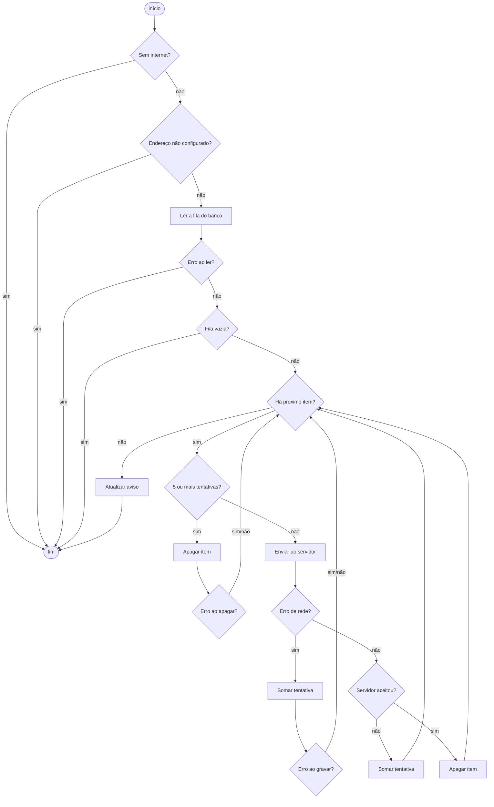
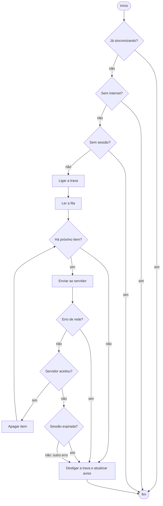

# Relatório de Testes — Funcionalidades offline (caixa-branca)

- **Aluno:** Davi Santiago de Jesus
- **Data:** 12/11/2026
- **Tipo de teste:** caixa-branca (estrutural), automatizado com `node:test`
- **Complementa:** o [relatório de caixa-preta](README.md) da mesma funcionalidade

## Objetivo

O teste de caixa-preta mostrou *o que* falha no uso offline. Este teste olha o código por dentro para responder outras perguntas:

- Todos os caminhos da fila offline foram executados pelo menos uma vez?
- Os defeitos vistos no navegador têm a causa que o relatório de caixa-preta aponta?
- Existem caminhos com problema que o uso normal não deixa aparecer?

## O que foi testado

A lógica offline das duas telas não está em módulos separados. Ela está escrita dentro dos próprios HTML, e foram testadas as 9 funções responsáveis por guardar, enviar e sincronizar:

| App | Função | Onde está | O que faz |
|---|---|---|---|
| Cidadão | `flushQueue` | [public/index.html:1271](../../../public/index.html) | Envia os reportes guardados no aparelho |
| Cidadão | `submitReport` | [public/index.html:1502](../../../public/index.html) | Decide entre enviar agora ou guardar na fila |
| Cidadão | `postReport` | [public/index.html:1481](../../../public/index.html) | Faz a requisição ao servidor (limite de 60 s) |
| Cidadão | `updatePendingBanner` | [public/index.html:1259](../../../public/index.html) | Mostra o aviso de reportes pendentes |
| Cidadão | `generateProtocol` | [public/index.html:1460](../../../public/index.html) | Gera o protocolo mostrado ao cidadão |
| Técnico | `flushQueue` | [public/tecnico/index.html:1868](../../../public/tecnico/index.html) | Envia os fechamentos guardados no aparelho |
| Técnico | `apiFetchTO` | [public/tecnico/index.html:1651](../../../public/tecnico/index.html) | Faz a requisição ao servidor com limite de tempo |
| Técnico | `renderPendingBanner` | [public/tecnico/index.html:1852](../../../public/tecnico/index.html) | Mostra o aviso de fechamentos pendentes |
| Técnico | `queueCount` | [public/tecnico/index.html:1717](../../../public/tecnico/index.html) | Conta a fila (usada no limite de 10 fechamentos) |

## Como os testes funcionam

Para testar o código que realmente roda no app sem alterar nenhum arquivo, o [apoio de extração](../../../server/tests/testes-offline/apoio/extrair-funcao.js) faz duas coisas:

1. **Recorta a função do HTML pelo nome.** O recorte respeita strings, template literals e comentários, para não confundir uma chave `{` dentro de um texto com o fim da função.
2. **Executa o recorte num ambiente isolado (`node:vm`).** O banco do aparelho (IndexedDB), a rede (`fetch`), os temporizadores e a tela são trocados por dublês que o teste controla. Assim o teste decide, por exemplo, que o servidor recusa o primeiro envio ou que o banco falha ao gravar.

Se alguém mudar uma dessas funções no HTML, o teste passa a exercitar a versão nova. Se a função for renomeada ou removida, o teste falha avisando que não a encontrou.

Os testes ficam em [server/tests/testes-offline/caixa-branca/](../../../server/tests/testes-offline/caixa-branca/) e entram no `npm test`, porque não precisam de navegador.

### Testes que confirmam defeitos

Cinco testes exigem o comportamento **correto** e falham hoje. Eles estão marcados como `todo` no `node:test`: a falha aparece com ⚠ na saída, mas não quebra o `npm test`. Quando o defeito for corrigido, o teste passa sozinho e a marcação pode ser retirada.

## Técnicas utilizadas

- **Caminhos básicos (McCabe):** para as duas funções `flushQueue`, montei o grafo de fluxo, calculei a complexidade ciclomática e escrevi pelo menos um teste por caminho independente.
- **Cobertura de comandos e de decisões:** cada `if`, `catch` e laço foi exercitado nos dois sentidos. A cobertura foi medida pelo próprio motor do JavaScript (V8), não estimada.
- **Valor limite:** no número de tentativas da fila do cidadão (4 e 5) e na contagem da fila do técnico.
- **Teste de concorrência:** três sincronizações disparadas ao mesmo tempo, como acontece quando a internet volta, o app volta ao primeiro plano e o timer de 60 s coincidem.

## Grafos de fluxo e caminhos básicos

A complexidade ciclomática foi calculada como V(G) = decisões + 1, contando os `if`, os laços e os `catch`. Os operadores `&&` e `||` dentro de uma mesma condição não foram contados à parte.

### `flushQueue` do cidadão — V(G) = 11



| Caminho | Decisão exercitada | Teste |
|---|---|---|
| 1 | Sem internet | CB-01 |
| 2 | Endereço do servidor não configurado | CB-02 |
| 3 | Erro ao ler o banco | CB-03 |
| 4 | Fila vazia | CB-04 |
| 5 | Envio aceito | CB-05 |
| 6 | Servidor recusou | CB-06, CB-06b |
| 7 | Erro de rede | CB-07, CB-07b |
| 8 | Item com 5 tentativas é descartado | CB-08 |
| 9 | Erro ao apagar o item descartado | CB-09 |
| 10 | Erro ao gravar a tentativa | CB-10 |
| 11 | Laço com mais de um item, o primeiro falhando | CB-11 |

### `flushQueue` do técnico — V(G) = 8



| Caminho | Decisão exercitada | Teste |
|---|---|---|
| 1 | Já sincronizando (trava) | CB-36 |
| 2 | Sem internet | CB-30 |
| 3 | Sem sessão | CB-31 |
| 4 | Fila vazia | CB-32 |
| 5 | Todos aceitos | CB-33 |
| 6 | Sessão expirada | CB-34 |
| 7 | Outro erro do servidor | CB-38 (confirma o defeito D5) |
| 8 | Erro de rede | CB-35 |
| extra | Exceção ao ler a fila (vai direto ao `finally`) | CB-37 |

As duas setas "sessão expirada" e "outro erro" levam ao mesmo lugar: **qualquer** recusa do servidor interrompe a fila inteira. Essa é a causa do defeito D5.

### Demais funções

| Função | V(G) | Testes |
|---|---|---|
| `submitReport` (cidadão) | 7 | CB-16 a CB-23 |
| `postReport` (cidadão) | 2, mais o cancelamento por tempo | CB-24 a CB-28 |
| `updatePendingBanner` (cidadão) | 4 | CB-14, CB-15 |
| `generateProtocol` (cidadão) | 1 | CB-29 |
| `apiFetchTO` (técnico) | 1, mais o cancelamento por tempo | CB-39, CB-39b, CB-40 |
| `renderPendingBanner` (técnico) | 3 | CB-41 |
| `queueCount` (técnico) | 2 | CB-42 |

## Resultado

Foram executados **45 testes: 40 aprovados e 5 que confirmam defeitos (todo)**, sem nenhuma falha inesperada. A suíte completa do projeto (`npm test`) passou a ter 80 testes: os 35 anteriores continuam aprovados.

- [Saída da execução](evidencias/execucao-caixa-branca.txt)
- [Medição de cobertura](evidencias/cobertura-caixa-branca.txt)

### Cobertura

| Função | Linhas | Ramos |
|---|---|---|
| `flushQueue` (cidadão) | 23/23 | 27/27 |
| `submitReport` (cidadão) | 26/26 | 15/15 |
| `postReport` (cidadão) | 17/17 | 4/4 |
| `updatePendingBanner` (cidadão) | 11/11 | 13/13 |
| `generateProtocol` (cidadão) | 5/5 | 1/1 |
| `flushQueue` (técnico) | 21/21 | 16/16 |
| `apiFetchTO` (técnico) | 10/10 | 5/5 |
| `renderPendingBanner` (técnico) | 11/11 | 9/9 |
| `queueCount` (técnico) | 2/2 | 2/2 |

O relatório de cobertura do `node --test` não enxerga código executado dentro do `node:vm`. Por isso escrevi um [script de medição](../../../server/tests/testes-offline/apoio/cobertura-caixa-branca.js) que lê a cobertura bruta do V8 e a recorta para cada função. "Ramos" são os blocos que o V8 separa: o lado verdadeiro e o falso de cada `if`, cada `catch` e o trecho depois de um `return` antecipado.

A primeira medição mostrou três ramos que nenhum teste executava: erro de rede sem mensagem no cidadão, o fim do tempo limite no técnico e a tela sem o aviso de pendentes no técnico. Acrescentei os testes CB-07b, CB-39b e um trecho no CB-41 para cobri-los.

### Todos os casos

| Caso | Função | O que verifiquei | Resultado |
|---|---|---|---|
| CB-01 | `flushQueue` (cidadão) | Sem internet, não lê a fila nem envia. | Aprovado |
| CB-02 | `flushQueue` (cidadão) | Com o endereço ainda não configurado (`__...`), não envia. | Aprovado |
| CB-03 | `flushQueue` (cidadão) | Erro ao ler o banco encerra sem enviar e sem lançar erro. | Aprovado |
| CB-04 | `flushQueue` (cidadão) | Fila vazia encerra sem enviar. | Aprovado |
| CB-05 | `flushQueue` (cidadão) | Envio aceito apaga o item e atualiza o aviso. | Aprovado |
| CB-06 | `flushQueue` (cidadão) | Recusa mantém o item e soma uma tentativa com o motivo. | Aprovado |
| CB-06b | `flushQueue` (cidadão) | Resposta vazia conta como recusa ("server error"). | Aprovado |
| CB-07 | `flushQueue` (cidadão) | Erro de rede mantém o item e soma uma tentativa. | Aprovado |
| CB-07b | `flushQueue` (cidadão) | Erro de rede sem mensagem é registrado como "network error". | Aprovado |
| CB-08 | `flushQueue` (cidadão) | Valor limite: com 4 tentativas ainda envia; com 5 descarta sem enviar. | Aprovado |
| CB-09 | `flushQueue` (cidadão) | Erro ao apagar um item descartado não interrompe a fila. | Aprovado |
| CB-10 | `flushQueue` (cidadão) | Erro ao gravar a tentativa não interrompe a fila. | Aprovado |
| CB-11 | `flushQueue` (cidadão) | Falha no primeiro item não impede o envio do segundo. | Aprovado |
| CB-12 | `flushQueue` (cidadão) | Item descartado deve avisar o cidadão. | ⚠ Confirma D1 |
| CB-13 | `flushQueue` (cidadão) | Três sincronizações simultâneas devem enviar uma única vez. | ⚠ Confirma D2 |
| CB-14 | `updatePendingBanner` | Esconde com 0; singular com 1; plural com 3. | Aprovado |
| CB-15 | `updatePendingBanner` | Erro no banco ou tela sem o aviso não quebram o app. | Aprovado |
| CB-16 | `submitReport` | Segundo toque durante o envio é ignorado. | Aprovado |
| CB-17 | `submitReport` | Com internet e envio aceito: "enviado", sem gravar na fila. | Aprovado |
| CB-18 | `submitReport` | Com internet e recusa do servidor: guarda na fila. | Aprovado |
| CB-19 | `submitReport` | Com internet e erro de rede: guarda na fila. | Aprovado |
| CB-20 | `submitReport` | Falha no envio e na gravação: mensagem de erro e botão liberado. | Aprovado |
| CB-21 | `submitReport` | Sem internet: grava direto na fila, sem tentar enviar. | Aprovado |
| CB-22 | `submitReport` | Sem internet e sem conseguir gravar: mensagem de erro. | Aprovado |
| CB-23 | `submitReport` | Com internet e endereço não configurado: guarda na fila. | Aprovado |
| CB-24 | `postReport` | Envia formulário com `payload` em JSON, lê a resposta e limpa o timer. | Aprovado |
| CB-25 | `postReport` | Resposta que não é JSON vira recusa. | Aprovado |
| CB-26 | `postReport` | Erro de rede é repassado e o timer é limpo. | Aprovado |
| CB-27 | `postReport` | Depois de 60 s sem resposta, a requisição é cancelada. | Aprovado |
| CB-28 | `postReport` | Com a API Node, deve enviar JSON com o campo `id`. | ⚠ Confirma D4 |
| CB-29 | `generateProtocol` | Formato `IC-AAMMDD-XXXXX` com zero à esquerda (05/01/2026 → `IC-260105-…`). | Aprovado |
| CB-30 | `flushQueue` (técnico) | Sem internet, não envia. | Aprovado |
| CB-31 | `flushQueue` (técnico) | Sem sessão, não envia. | Aprovado |
| CB-32 | `flushQueue` (técnico) | Fila vazia libera a trava e atualiza o aviso. | Aprovado |
| CB-33 | `flushQueue` (técnico) | Todos aceitos são apagados na ordem da fila. | Aprovado |
| CB-34 | `flushQueue` (técnico) | Sessão expirada interrompe e mantém a fila. | Aprovado |
| CB-35 | `flushQueue` (técnico) | Erro de rede interrompe e mantém a fila. | Aprovado |
| CB-36 | `flushQueue` (técnico) | Três sincronizações simultâneas enviam cada fechamento uma vez. | Aprovado |
| CB-37 | `flushQueue` (técnico) | Erro ao ler a fila libera a trava, mas o erro escapa da função. | Aprovado (ver O1) |
| CB-38 | `flushQueue` (técnico) | Erro do servidor em um fechamento não deve travar os seguintes. | ⚠ Confirma D5 |
| CB-39 | `apiFetchTO` | Envia JSON como `text/plain`, usa 15 s por padrão e limpa o timer. | Aprovado |
| CB-39b | `apiFetchTO` | Esgotado o tempo limite, a requisição é cancelada. | Aprovado |
| CB-40 | `apiFetchTO` | Com a API Node, o fechamento deve ir para `/api/chamados/{protocolo}/fechamento`. | ⚠ Confirma D6 |
| CB-41 | `renderPendingBanner` | Singular, plural, "enviando…" e "sem sinal"; tela sem o aviso. | Aprovado |
| CB-42 | `queueCount` | Erro ao ler a fila conta como 0. | Aprovado (ver O2) |

## O que a caixa-branca acrescentou

### Causas confirmadas dos defeitos

D1 a D6 correspondem aos itens 1 a 6 da lista de [defeitos do relatório de caixa-preta](README.md#defeitos-encontrados).

- **D1 (CB-08, CB-12):** o descarte é intencional no código (`MAX_ATTEMPTS = 5`), mas só gera um `console.warn`, que o cidadão não vê. O CB-08 mostra também que o item com 5 tentativas é apagado **na execução seguinte, sem uma nova tentativa**. Por isso, no navegador, o reporte sumiu na 6ª sincronização.
- **D2 (CB-13 × CB-36):** a comparação entre os dois apps mostra a causa exata. O técnico tem a trava `flushInFlight` e envia uma vez (CB-36 aprovado). O cidadão não tem trava: cada chamada lê uma cópia da fila antes de qualquer item ser apagado, e o mesmo protocolo é enviado 3 vezes (CB-13).
- **D4 (CB-24, CB-28):** `postReport` monta sempre um formulário (`URLSearchParams`), sem cabeçalho JSON e sem `id`, qualquer que seja o servidor configurado.
- **D5 (CB-38):** no `flushQueue` do técnico, todo resultado diferente de sucesso termina em `break`. Não há um caminho que pule só o item com erro.
- **D6 (CB-40):** `apiFetchTO` envia sempre para o endereço base (`/api`) no formato do Apps Script. Não há tradução para as rotas da API Node.

### Observações novas

- **O1 — Erro escapa da sincronização do técnico (CB-37).** Se o banco do aparelho falhar na leitura, o `flushQueue` do técnico libera a trava corretamente, mas o erro sai da função. Quem a chama (`setTimeout` e o retorno ao primeiro plano) não trata esse erro, que aparece como "Uncaught (in promise)" no console. A fila não trava. Gravidade baixa.
- **O2 — Limite de 10 fechamentos depende do banco (CB-42).** `queueCount` devolve 0 quando o banco falha, então a checagem do limite sempre passa. Na prática, com o banco falhando a gravação também falha e o técnico vê "Erro ao salvar localmente". Gravidade baixa.

### O que a caixa-branca não alcança

- **D3 (rascunho perdido):** não existe código que guarde o rascunho do formulário. Teste de caixa-branca mede o código que existe, então esse defeito só aparece no teste de caixa-preta (CP-12).
- **Limite de 10 fechamentos:** a checagem fica dentro de `fecharChamado`, uma função longa e muito ligada à tela. Ela foi coberta pelo teste de caixa-preta (CP-21), não por este.
- **IndexedDB e rede reais:** aqui eles são dublês. O comportamento com o navegador de verdade é verificado pelo teste de caixa-preta.
- **100% de ramos não significa ausência de defeitos:** os 5 defeitos confirmados estão em código 100% coberto. A cobertura garante que cada caminho foi executado e verificado, não que o caminho faça a coisa certa.

## Como repetir

Na raiz do projeto, só os testes de caixa-branca:

```bash
node --test "server/tests/testes-offline/caixa-branca/*.test.js"
```

A suíte completa, que já inclui esses testes:

```bash
npm --prefix server test
```

A medição de cobertura, que regrava o arquivo de evidências:

```bash
node server/tests/testes-offline/apoio/cobertura-caixa-branca.js
```

Para medir a cobertura de só alguns testes, passe um filtro pelo nome, por exemplo `node server/tests/testes-offline/apoio/cobertura-caixa-branca.js "CB-0[1-5]"`.

**Davi Santiago de Jesus**
